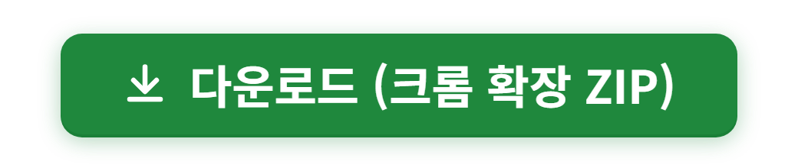
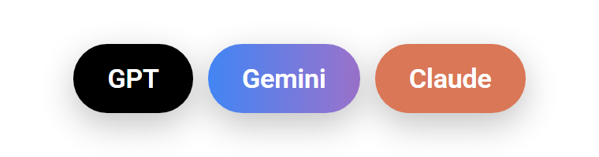
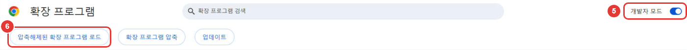
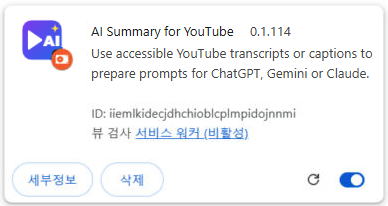
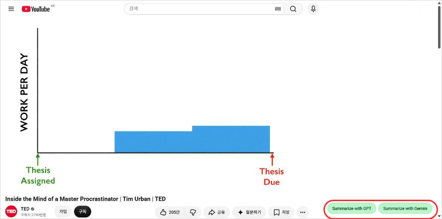
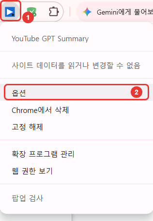
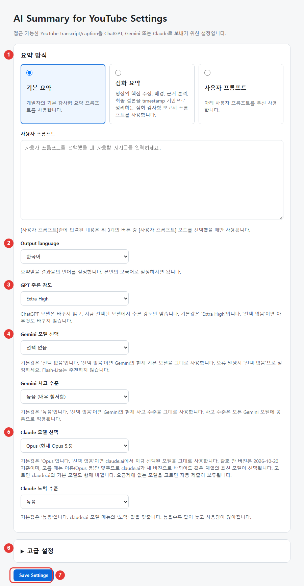

# AI Summary for YouTube

유튜브 영상의 자막(스크립트)을 ChatGPT, Gemini, Claude에 넘겨서 버튼 한 번으로 요약을 받는 크롬 확장 프로그램입니다. (예전 이름: YouTube GPT Summary)

 
누르면 최신 버전 ZIP 파일이 바로 받아집니다. 받은 뒤 아래 <b>설치</b>를 따라 하세요.

- 설치하면 유튜브 영상 페이지 오른쪽 아래에 이 세 버튼이 생깁니다.
- 누르면 새 탭에서 ChatGPT 임시 채팅, Gemini 임시 채팅 또는 Claude 시크릿 대화가 열리고, 자막 전체와 요약 프롬프트가 자동으로 입력·전송됩니다.
- 무료, 광고 없음, 별도 서버 없음. 자막은 브라우저 안에서 처리되어 사용자가 누른 서비스로만 갑니다.

## 설치 (처음 한 번, 3분)

크롬 웹스토어에는 올라가 있지 않아서, 받은 파일을 크롬에 직접 넣는 방식입니다. 그림의 빨간 번호가 단계 번호입니다.

**1.** 맨 위의 초록색 **다운로드** 버튼을 누릅니다. `youtube-gpt-summary.zip` 파일이 '다운로드' 폴더에 받아집니다.

**2.** 받은 파일의 압축을 풉니다. `youtube-gpt-summary` 폴더가 생깁니다. **이 폴더는 지우지 마세요.** 크롬이 계속 이 폴더에서 확장을 읽습니다.

**3.** 크롬 주소창에 `chrome://extensions` 를 입력하고 Enter를 누릅니다.

**4.** 오른쪽 위의 **개발자 모드** 스위치를 켭니다.

**5.** 왼쪽 위에 생긴 **압축해제된 확장 프로그램 로드** 를 누르고, 2번에서 생긴 `youtube-gpt-summary` 폴더를 고른 뒤 **폴더 선택** 을 누릅니다.

**6.** 목록에 아래 카드가 보이면 끝입니다. 이미 열려 있던 유튜브 탭은 새로고침(F5)하세요.

쓰려는 서비스(ChatGPT, Gemini, Claude)에 미리 로그인돼 있어야 합니다.

## 사용법

1. 유튜브 영상 페이지를 엽니다.
2. 오른쪽 아래 **GPT**, **Gemini**, **Claude** 중 하나를 누릅니다. 버튼이 진한 색이면 자막을 미리 받아 둔 상태라 바로 열립니다(흐리면 아직 받는 중).

   

3. 새 탭에서 요약이 시작됩니다. 자동 전송이 안 됐으면 입력창에 들어간 내용을 그대로 보내면 됩니다(프롬프트는 클립보드에도 복사됩니다).

자막이 없는 영상은 탭을 열지 않고 버튼에 `Transcript unavailable`이 잠깐 뜹니다.

## 설정

**여는 법**: 크롬 오른쪽 위의 이 확장 아이콘을 마우스 오른쪽 버튼으로 누르고 **옵션** 을 누릅니다.

> 아이콘이 안 보이면 주소창 오른쪽의 퍼즐 모양 버튼을 누르고, AI Summary for YouTube 옆의 압정 모양을 눌러 고정하세요.

| 번호 | 항목 | 설명 |
| :-: | --- | --- |
| 1 | 요약 방식 | **기본 요약**: 핵심만 짧게 정리합니다. **심화 요약**: 핵심 주장, 배경, 근거, 결론을 영상 시간과 함께 자세히 정리합니다. **사용자 프롬프트**: 아래 칸에 직접 쓴 지시문으로 요약합니다. 칸에 쓴 내용은 이걸 골랐을 때만 쓰입니다. |
| 2 | Output language | 요약을 받을 언어입니다. 기본값은 한국어입니다. |
| 3 | GPT 추론 강도 | ChatGPT가 얼마나 깊게 생각할지 정합니다. Instant(빠름)부터 Medium, High, Extra High, Pro(가장 깊음) 순입니다. 기본값은 **Extra High** 입니다. **No selection** 이면 ChatGPT에 이미 설정된 그대로 둡니다. 모델은 바꾸지 않습니다. |
| 4 | Gemini 모델 / 사고 수준 | Gemini 모델(3.5 Flash-Lite, 3.8 Flash, 3.1 Pro, 4 Argon)과 사고 수준(낮음, 보통, 높음)을 고릅니다. 기본값은 모델 **선택 없음**, 사고 수준 **높음** 입니다. **선택 없음** 이면 Gemini에 지금 선택된 그대로 둡니다. 오류가 나면 선택 없음으로 돌리세요. |
| 5 | Claude 모델 / 노력 수준 | Claude 모델(Fable, Opus, Sonnet, Haiku. 괄호 안은 지금 버전이며, 이름으로 고르므로 claude.ai가 새 버전을 내도 그 계열 최신 모델이 선택됨)과 노력(낮음, 중간, 높음, 엑스트라, 최대)을 고릅니다. 기본값은 **Opus**, 노력 **높음** 입니다. **선택 없음** 이면 claude.ai에 지금 선택된 그대로 둡니다. 고르면 claude.ai 쪽 기본 선택도 같이 바뀝니다. |
| 6 | 고급 설정 | 눌러서 펼칩니다. 네 항목 모두 기본은 켜짐입니다. **빠른 사전 추출**: 영상에 들어가자마자 자막을 미리 받아 둡니다(버튼이 진한 색이 됨). **ChatGPT 임시채팅**: 끄면 일반 채팅으로 보냅니다. **Claude 시크릿 모드**: 끄면 일반 대화로 보냅니다. 켜져 있는데 시크릿 모드가 확인되지 않으면 입력하지 않고 클립보드에만 남깁니다. **자동 제출**: 끄면 입력만 하고 전송은 직접 합니다. |
| 7 | Save Settings | 바꾼 뒤 **꼭 눌러야 저장됩니다.** |

## 업데이트

1. 맨 위 **다운로드** 버튼으로 새 ZIP을 받아 압축을 풉니다.
2. 새로 나온 파일들을 처음 설치한 `youtube-gpt-summary` 폴더에 **덮어씁니다**(같은 이름 파일은 '바꾸기').
3. `chrome://extensions` 에서 AI Summary for YouTube 칸의 새로고침(↻) 버튼을 누르고, 열려 있던 유튜브·ChatGPT·Gemini·Claude 탭을 새로고침합니다.

같은 폴더를 쓰면 설정이 그대로 남습니다.

## 알아둘 점

- ChatGPT·Gemini·Claude·유튜브 화면이 바뀌면 자동 입력이나 모델 선택이 잠시 안 될 수 있습니다. 그럴 땐 새 버전을 기다리거나, 입력창 내용을 직접 보내면 됩니다.
- 모든 영상에 자막이 있지는 않습니다.
- AI 요약은 틀릴 수 있습니다. 중요한 내용은 원본 영상으로 확인하세요.
- YouTube, Google, OpenAI, Anthropic과 관계없는 개인 도구입니다.

## 개인정보

개발자 서버로 아무것도 보내지 않습니다. 자세한 내용은 [개인정보처리방침](https://igayowai.github.io/youtube-gpt-summary/privacy.html)을 보세요.

문의: 408200jj@gmail.com · 개발 기록과 버전별 변경은 [docs/DEVELOPMENT.md](docs/DEVELOPMENT.md)

---

## English

A Chrome extension that sends a YouTube video's transcript to ChatGPT, Gemini or Claude and gets a summary in one click. It adds **GPT** / **Gemini** / **Claude** buttons to the bottom-right of video pages; the prompt is filled in and sent in a temporary chat (Claude: incognito chat). Free, no ads, no developer server.

Install: [download the ZIP](https://github.com/igayowai/youtube-gpt-summary/releases/latest/download/youtube-gpt-summary.zip), unzip it to a folder you keep, open `chrome://extensions`, turn on **Developer mode**, click **Load unpacked**, and select that folder. Options: right-click the extension icon and choose **Options**. [Privacy policy](https://igayowai.github.io/youtube-gpt-summary/privacy.html).

License: [LICENSE](LICENSE)
